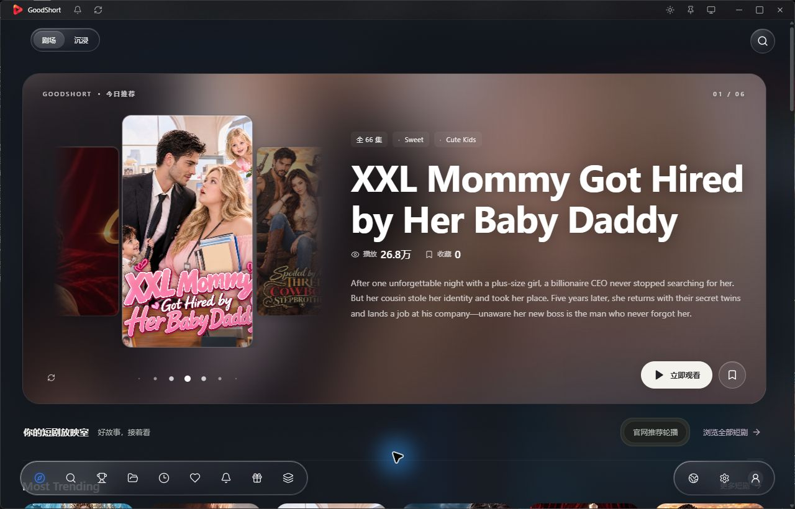

### 你的短剧放映室，现在叫 DRAVO。

多平台片库 · 剧场与沉浸播放 · AI 字幕 · 收藏续播 · 项目管理

**[下载 Windows 安装版](https://github.com/sabermasterlc/dramabox-desktop-releases/releases/download/v1.1.2/DRAVO_1.1.2_x64-setup.exe)** · **[下载完整免安装版](https://github.com/sabermasterlc/dramabox-desktop-releases/releases/download/v1.1.2/DRAVO-1.1.2-windows-x64-portable.zip)** · **[Mac 原生新界面预览](https://github.com/sabermasterlc/dramabox-desktop-releases/releases/tag/v0.1.0-macos-native-preview)**

[这次更新](#dravo-112这次有什么不同) · [平台接入状态](#平台接入状态) · [使用指南](#下载与升级) · [反馈问题](https://github.com/sabermasterlc/dramabox-desktop-releases/issues)

---

DRAVO 由原 DramaBox 桌面客户端升级而来，把片库浏览、平台切换、播放和本机记录放进同一款桌面软件。选一部剧，在大屏上看；需要兼顾其他事情时，切到置顶小窗，之后接着上次的进度继续。

**新名字，原来的使用记录。** 本次 Windows 迭代沿用旧软件的应用标识、数据目录和更新渠道。DramaBox 作为内容平台仍保留原名；窗口左上角显示当前片源自己的图标与名称。

*上图为 1.1.0 Windows 程序实际运行截图。平台海报与作品资料归各自权利人所有。*

## DRAVO 1.1.2：这次有什么不同

| 更新 | 使用时的变化 |
| --- | --- |
| **四家新增公开播放** | NetShort、ShortMax、MoboReels、Vigloo 的英文官网免费章节，已接入软件内统一播放器。 |
| **连续观影操作** | 四家样片已检查出画、音频解码、拖动与切集；Vigloo 另已验证一次自动进入下一集。 |
| **图标跟随片源** | 窗口左上角随平台切换对应图标和名称。 |
| **原记录继续使用** | 保留原应用标识、数据目录、收藏、观看记录和签名更新通道。 |
| **明确播放边界** | 以作品实时免费范围为准；新增平台账号、会员和付费权益未接通。 |
| **原有工具保留** | 剧场、沉浸、小窗、收藏续播、字幕和项目管理仍按当前平台能力使用。 |

## 平台接入状态

不同平台的接入深度不同。下表是 **Windows 1.1.2** 的实际范围。

| 平台 | 片库与资料 | 播放与选集 |
| --- | --- | --- |
|  **DramaBox** | 保留现有片库、搜索与详情 | 保留现有播放链，按官网逐集授权 |
|  **ReelShort** | 公开英文片库 | 已有公开免费集适配；付费与账号权益待接入 |
|  **GoodShort** | 公开英文片库、作品资料与目录 | 已有公开免费集适配；付费与账号权益待接入 |
|  **ShortMax** | 真实英文片库、作品资料与选集 | **公开免费集已接通**；付费与账号权益待接入 |
|  **NetShort** | 真实英文片库、作品资料与目录 | **公开免费集已接通**；付费与账号权益待接入 |
|  **Vigloo** | 公开榜单片库、作品资料与单季目录 | **公开免费集已接通**；仅无 DRM 且明确免费的章节 |
|  **MoboReels** | 真实英文首页栏目、作品资料与选集 | **公开免费集已接通**；付费与账号权益待接入 |
|  **Shortime** | 待接入 | 当前不开放切换 |
|  **PineDrama** | 待接入 | 当前不开放切换 |

新增四家的搜索目前只筛选已读取的首页片库，不是全站搜索。免费集数以每部作品实时返回的权限为准，不补齐未取得的目录或媒体。新平台账号、会员、云同步和实际视频下载尚未开放。ShortMax、MoboReels、Vigloo 暂不支持从视频识别对白，可以导入已有字幕。

## 为桌面观影准备的工具

| 功能 | 可以做什么 |
| --- | --- |
| **剧场与沉浸** | 浏览海报与推荐分区，进入沉浸播放，按需切换宽屏、竖屏、小窗和置顶。 |
| **AI 字幕** | 读取可用字幕，或在缺少字幕时识别音频；支持翻译、双语显示、样式调整、本机缓存与导出。首次使用按组件管理提示准备模型。[字幕指南](docs/ai-subtitles.md) |
| **收藏与续播** | 在本机保存收藏、历史和观看进度，支持导入、导出；不同平台与账号的记录分别保存。 |
| **项目与笔记** | 分开管理个人项目与作者项目，保存观影笔记和选集清单，查看公开指标及记录趋势。[项目数据指南](docs/project-data.md) |
| **播放控制** | 分组选集、自动下一集、倍速、全屏；音轨与字幕选项以片源实际提供为准。 |
| **预约与更新** | 软件运行期间检查支持的剧集更新；Windows 安装版可检查新软件版本，验签后由用户选择安装。 |

<b>查看字幕与项目功能预览</b>

以下为此前版本的功能参考截图，字幕样式页使用示例字幕；不代表 DRAVO 1.1.2 或 macOS 已完成全部实际使用验收。

| AI 字幕设置 | 字幕样式 |
| --- | --- |
|  |  |

| 作者项目 | 项目复盘 |
| --- | --- |
|  |  |

## 下载与升级

| 版本 | 下载 | 说明 |
| --- | --- | --- |
| **Windows 1.1.2 · x64** | [安装版](https://github.com/sabermasterlc/dramabox-desktop-releases/releases/download/v1.1.2/DRAVO_1.1.2_x64-setup.exe) · [完整免安装 ZIP](https://github.com/sabermasterlc/dramabox-desktop-releases/releases/download/v1.1.2/DRAVO-1.1.2-windows-x64-portable.zip) | Windows 10 / 11；使用系统 WebView2，AI 模型按需另行准备 |
| **macOS 原生 0.1.0 · 开发预览** | [Liquid Glass 新界面 ZIP](https://github.com/sabermasterlc/dramabox-desktop-releases/releases/download/v0.1.0-macos-native-preview/DramaBox-Native-macOS-arm64-dev.zip) | **Apple M 芯片、macOS 26+**；独立原生重建，功能尚未与 Windows 同步 |
| **macOS 0.16.0 · 历史预览版** | [Apple M 芯片 DMG](https://github.com/sabermasterlc/dramabox-desktop-releases/releases/download/v0.16.0-macos-preview/DramaBox_0.16.0_aarch64.dmg) | macOS 14+，仍使用 DramaBox 名称；**不是 DRAVO 1.1.2** |

### Windows 首次使用

1. 下载并安装 DRAVO，或完整解压免安装 ZIP 后运行其中的程序。保留 ZIP 中的资源目录。
2. 在首次页面选择平台。已接入平台可打开官网公开免费章节；Shortime、PineDrama 继续显示待接入。
3. 网络向导选择适合的方式。访问新增四家平台时，建议使用电脑上已有可访问官网的 **VPN／系统代理**；软件不会代你开启 VPN 或更改系统代理。

原 DramaBox 安装版用户可关闭旧软件后升级，也可通过原更新入口检查新版。安装器保留旧版升级识别和数据目录；实际覆盖安装、长期播放和会员流程仍需在用户设备上验证。此前独立 Platform Test 的测试数据不会自动合并。

免安装版继续使用原应用的数据目录，建议避免与旧版同时运行。需要自动安装更新时，请使用安装版。0.8.0 及更早版本须先手动安装新版。

关闭主窗口会暂停视频并收起到托盘；彻底退出请使用托盘菜单。macOS 预览版仍手动下载更新，其安装、签名和实机验证范围见 [历史说明](docs/legacy-dramabox.md#macos)。

### Mac 原生新界面预览

新原生包使用 SwiftUI、系统 Liquid Glass 和 AVKit，要求 **Apple M 芯片、macOS 26+**。解压 ZIP 后，将 `DramaBox Native.app` 拖到“应用程序”。应用仍显示原开发包名称，使用独立数据标识。

该包已通过云编译、4 项测试与开发签名结构检查；真实 Mac 启动、视觉交互和播放尚待验证。附加启动检查因 GitHub Mac runner 容量不足而未执行。账号、AI 字幕、项目管理及 Windows 多平台接入尚未迁移。[查看完整范围与源码说明](docs/native-macos-preview.md)

### 附件如何选择

- `DRAVO_1.1.2_x64-setup.exe`：Windows 安装包。
- `DRAVO-1.1.2-windows-x64-portable.zip`：免安装程序及完整配套资源。
- `SHA256SUMS.txt`：下载文件的一致性校验值。
- `latest.json` 与 `.sig`：软件更新器使用，无需手动打开。更新签名不等同 Windows Authenticode 发布者证书。

## 常见问题

**为什么有些剧集不能播放？** 新增四家只接入官网明确开放的免费章节。付费或未确认权限的章节会显示授权提示；Shortime、PineDrama 仍待接入。网络出口和官网变化也可能影响实际可用性。

**会员集可以直接看吗？** 播放仍按平台对当前章节的授权执行。账号、会员身份和单集播放权限分别核验；不同平台的权益互不通用。

**收藏会与手机同步吗？** 当前主要保存在本机；新平台云同步尚未接通。换电脑前可导出记录。

**为什么片库或海报加载失败？** 先检查所选平台、内容语言和连接方式。地区、网络出口、平台访问策略与网页变化都可能影响结果。公司 Wi-Fi 专用通道尚未覆盖全部新增平台域名。

**Mac 新版是哪一份？** 新发布的是原生 Liquid Glass **0.1.0 开发预览**，要求 Apple M 芯片和 macOS 26+；包内仍显示 DramaBox Native。它目前支持 DramaBox 公开片库及基础播放，账号、AI 字幕、项目管理和 Windows 新增多平台等能力尚未迁移。macOS 14+ 用户仍可查看旧 Tauri 0.16.0 历史预览版。[原生版完整范围](docs/native-macos-preview.md)

## 验证与反馈

本轮 Windows 验证：**444 项前端测试、74 项 Rust 常规测试通过**；生产构建、安装包签名和版本绑定验证通过，篡改文件与伪造版本均被拒绝。四家新增平台的样片已检查画面、音频解码、拖动与切集；音频计数不代表人工听音验收。

这些结果不替代实际覆盖安装、全片库播放、会员流程、长期运行或 Mac 实机验收。[完整版本说明](https://github.com/sabermasterlc/dramabox-desktop-releases/releases/tag/v1.1.2)

遇到问题请在 [Issues](https://github.com/sabermasterlc/dramabox-desktop-releases/issues) 提供系统与软件版本、平台、连接方式、剧名/集号、操作步骤和界面提示。请遮住账号、配对码和其他私人信息。

## 关于这个仓库

这是个人开发的非官方第三方客户端，与各内容平台无隶属关系。内容、商标与素材归各自权利人所有，访问以平台授权和可用性为准。

本仓库提供软件发行、使用说明、界面预览及已公开的作者项目数据；应用工程源码和发布凭据不在此公开。GitHub 自动生成的 “Source code” 压缩包包含本发行仓库文件，不是应用工程源码。

Windows 网络组件随包提供许可与对应源码归档，macOS 包不包含该 Windows 组件。平台标识仅用于说明当前来源。

[作者项目清单](projects.json) · [更名前的介绍与历史记录](docs/legacy-dramabox.md) · [全部发行版](https://github.com/sabermasterlc/dramabox-desktop-releases/releases)
