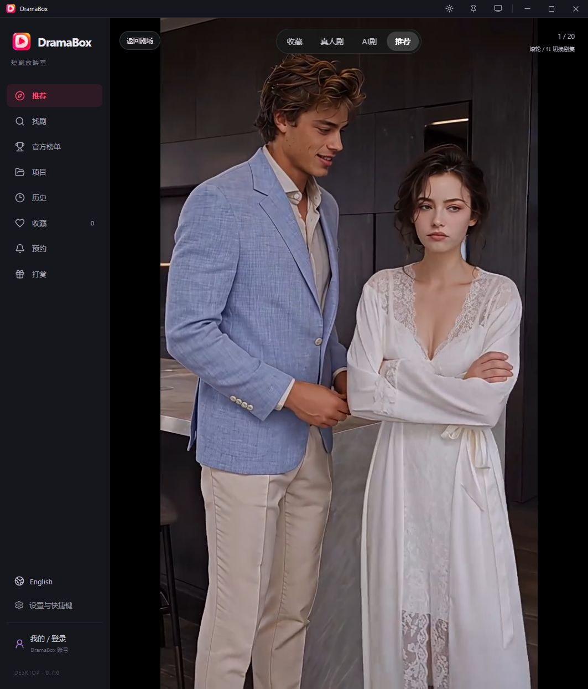
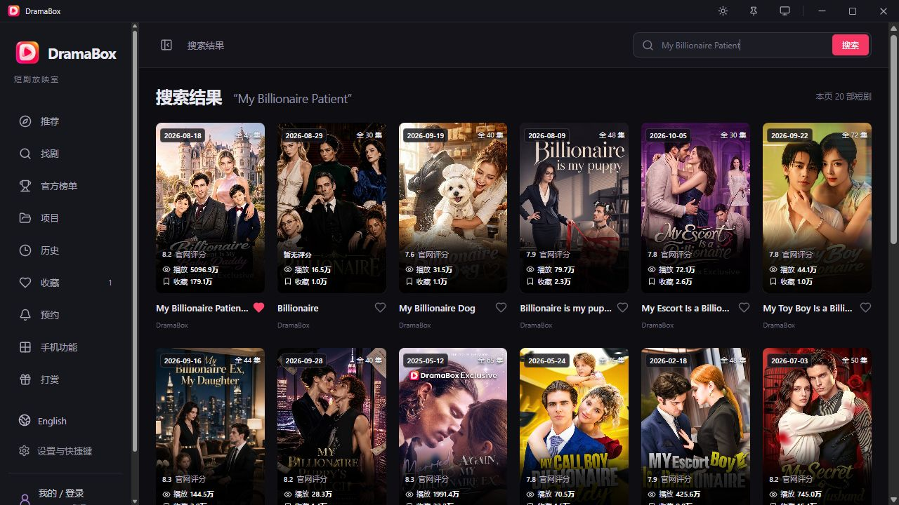
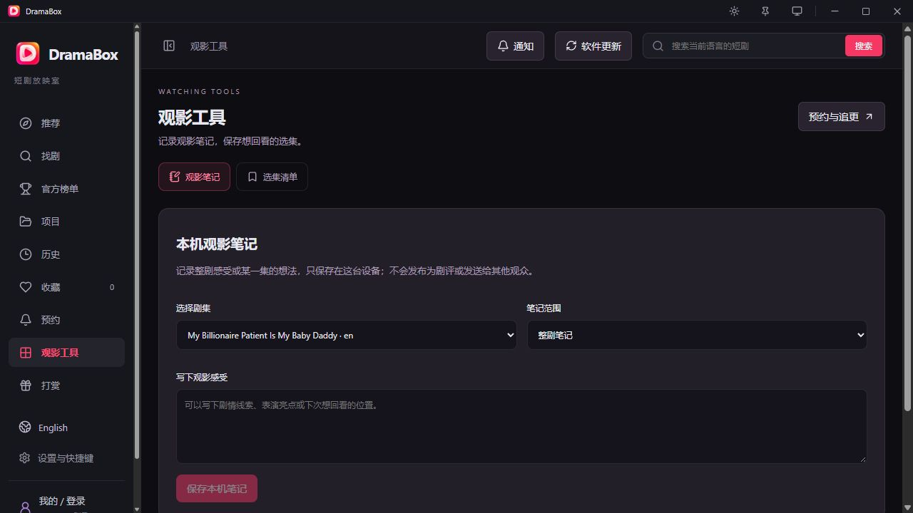
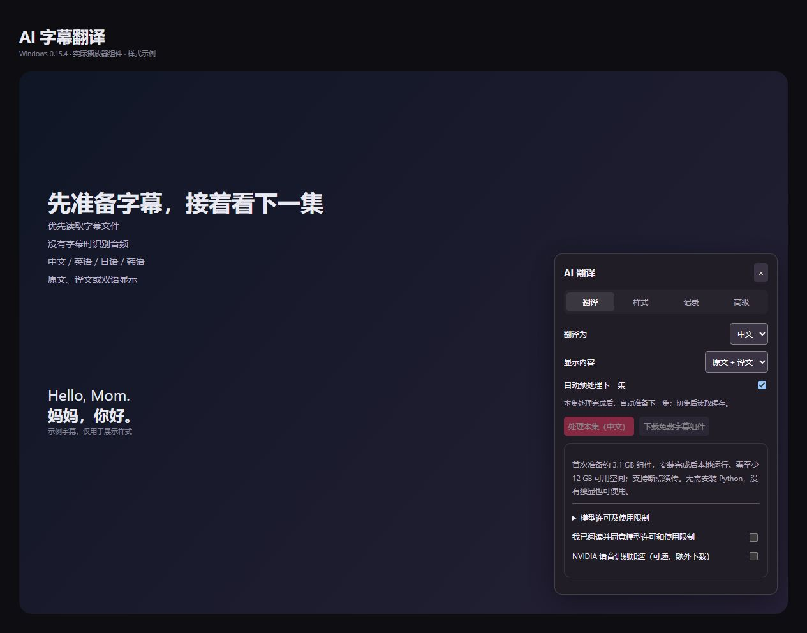
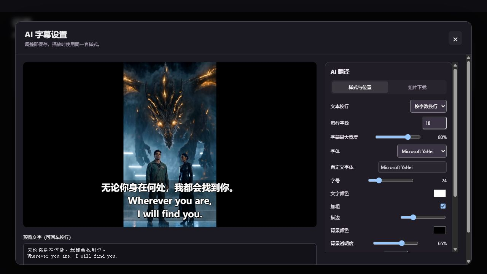
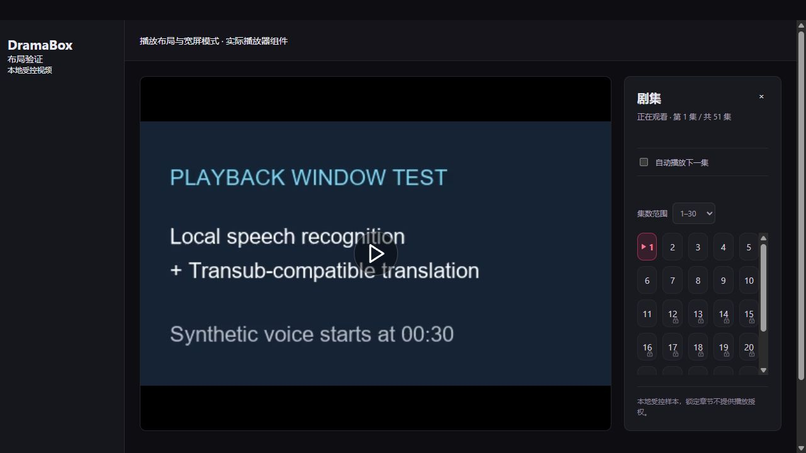
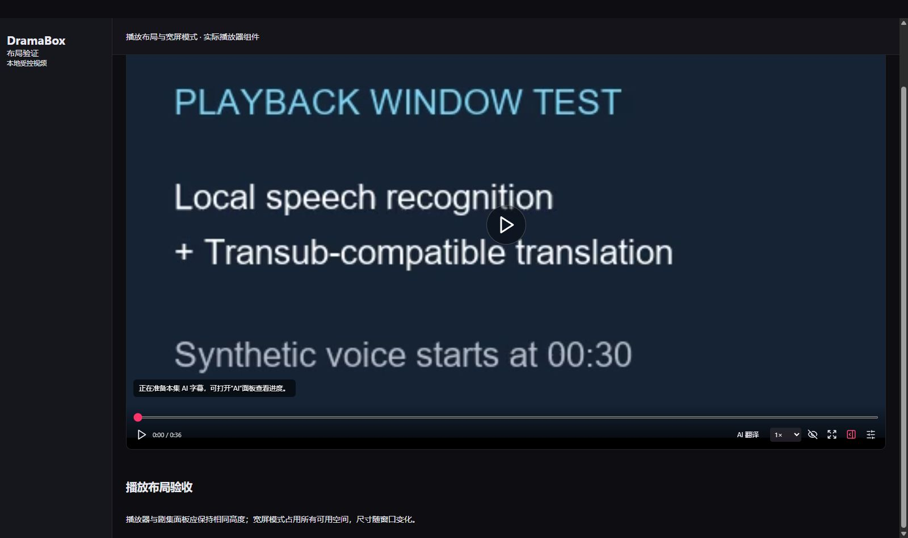

# DramaBox 短剧电脑版

### 在电脑上找剧、追剧，接着上次的进度看

AI 字幕翻译 · 剧场首页 · 沉浸播放 · 自动连播 · 竖屏小窗 · 收藏与续播 · 观影笔记 · 项目复盘

**[⬇ 下载 Windows 正式版 0.15.8](https://github.com/sabermasterlc/dramabox-desktop-releases/releases/download/v0.15.8/DramaBox_0.15.8_x64-setup.exe)** · **[🍎 下载 Mac 预览版](https://github.com/sabermasterlc/dramabox-desktop-releases/releases/tag/v0.16.0-macos-preview)** · **[查看全部版本](https://github.com/sabermasterlc/dramabox-desktop-releases/releases)**

Windows 10 / 11（64 位） · macOS 14+（新版仅 Apple M 系列芯片）

> macOS 0.16.0 为 Apple M 芯片专用 AI 字幕预览版。云端组件安装、修复、识别与中英双向翻译测试通过；真实 Mac 播放联动仍待验收。采用临时签名，未完成 Apple Developer ID 签名和公证。

## 🖥️ 这个项目能做什么？

DramaBox 是一个面向电脑使用的非官方短剧客户端。打开软件就能浏览 DramaBox 片库，搜索想看的剧，切换到沉浸播放；需要兼顾其他事情时，也可以使用竖屏或置顶小窗。

除了看剧，还能保存本机收藏和观看进度、写观影笔记，整理自己的项目，以及查看作者发布的作品与公开指标记录。

## ✨ 主要功能

| 功能 | 现在可以做什么 |
| --- | --- |
| 💬 AI 字幕翻译 | Windows 0.15.6 正式版：优先读取可用字幕文件，无字幕时识别音频；中 / 英 / 日 / 韩互译，原文、译文或双语显示；整集处理、自动预处理下一集、本机缓存与字幕导出。[功能详情](docs/ai-subtitles.md) |
| 🎨 字幕样式 | 自定义字体、字号、颜色、描边和背景透明度，支持调整字幕位置；精简播放条，按需显示其他按钮。 |
| 🎬 剧场与沉浸播放 | 浏览推荐分区，从剧场进入沉浸模式，随时返回片库。 |
| 🔍 搜索与找剧 | 搜索联想、分页、最近搜索；按官网提供的分类和剧种标签筛选；可查看官网推荐与当前首页剧目的观看、追剧指标排序。 |
| 🌍 多语言片库 | 切换官网提供的 17 种内容语言；软件界面保持中文。 |
| ▶️ 播放与续播 | 分组选集、自动下一集、倍速、音量、全屏、播放进度保存；片源提供时可选择音轨与字幕。 |
| ↔️ 宽屏模式 | 播放设置按钮左侧一键隐藏 / 恢复剧集面板，播放器填满当前可用宽度；跟随窗口尺寸变化，保留播放进度。剧集面板与播放器上下对齐。 |
| 🪟 桌面观影 | 竖屏模式、小窗、置顶、悬停隐藏、深色与浅色主题。Mac 窗口行为待实机确认。 |
| ❤️ 收藏与历史 | 本机保存；按登录账号分区，支持旧记录预览迁移、导入与导出。 |
| 🔔 预约与通知 | 按剧名预约上线、关注选集更新，在软件运行并联网时检查，结果进入本机通知中心。 |
| 📝 观影工具 | 保存整剧或分集笔记、整理选集清单，方便回看与复盘。选集清单不等于离线下载。 |
| 📁 项目与数据 | 分开管理“我的项目”和“作者项目”；同步作者发布的作品清单及公开指标，查看历史趋势；“我的项目”自动采集默认关闭，可设置 1—1440 分钟间隔。[数据记录详情](docs/project-data.md) |
| 🔄 Windows 更新 | 0.9.0 及以上安装版支持软件内检查更新、验签后安装。Mac 暂不提供自动更新。 |

**内容与账号范围：** 当前片库和播放来自 DramaBox 官网链路；能否播放以官网对当前章节返回的授权为准。其他平台、官方排行榜、手机端收藏/历史同步、远端评论与实际视频下载尚未接通。本机笔记、弹幕等记录不会自动同步给其他观众。

## 📸 界面预览

剧场首页已更新为 Windows 0.15.2 界面，使用真实官网海报与已记录的公开指标验证展示；其余截图来自此前 Windows 版本。界面细节可能随版本调整，不代表 Mac 已完成实机验证。

| 剧场首页 | 沉浸播放 |
| --- | --- |
|  |  |

| 搜索与官网评分 | 观影笔记 |
| --- | --- |
|  |  |

### AI 字幕与项目数据

下列为当前源码实际组件的界面预览，项目使用官网已记录数据；字幕样式页使用示例字幕演示，不代表该示例经过翻译质量验收。

| AI 字幕翻译 | 字幕自定义样式 |
| --- | --- |
|  |  |

| 作者项目 | 项目数据复盘 |
| --- | --- |
|  |  |

### 宽屏与剧集布局

以下使用本地受控视频演示实际播放器组件，不代表平台播放或翻译质量验收。

| 标准模式 · 剧集面板与播放器等高 | 宽屏模式 · 自动占满可用宽度 |
| --- | --- |
|  |  |

[了解 AI 字幕：安装、语言、样式和预处理](docs/ai-subtitles.md) · [了解项目数据：来源、采集与历史归档](docs/project-data.md)

截图中的海报、剧名与视频画面属于各自权利人，仅用于说明软件界面。

## 📥 下载与安装

| 电脑类型 | 下载 | 当前状态 |
| --- | --- | --- |
| Windows 10 / 11 · 64 位 | [Windows 正式安装包](https://github.com/sabermasterlc/dramabox-desktop-releases/releases/download/v0.15.8/DramaBox_0.15.8_x64-setup.exe) | **0.15.8 正式版，已包含 AI 字幕、登录网络修复与选集界面优化**；安装包约 23.7 MB，AI 组件首次另下载约 3.16 GB |
| Mac · Apple 芯片（M 系列） | [Apple 芯片 DMG](https://github.com/sabermasterlc/dramabox-desktop-releases/releases/download/v0.16.0-macos-preview/DramaBox_0.16.0_aarch64.dmg) | macOS 14+ · 预览版 |

### Windows

1. 下载 `DramaBox_0.15.8_x64-setup.exe`，按安装向导完成安装。
2. 启动 DramaBox，按首次网络指南检查片库、封面和公开片源连接。
3. 以后在“设置与快捷键 → 软件更新”检查新版本。0.8.0 及更早版本需要先手动安装新版。

关闭主窗口会暂停视频并收起到托盘；需要彻底退出时，从托盘菜单选择“退出”。Windows 提供可选的 App 专用 Wi-Fi 通道，需要保持无线网络连接。

### macOS

1. 在“关于本机”确认是 Apple M 系列芯片，再下载 aarch64 DMG。新版停止 Intel 开发，历史 Intel 包仍保留在旧版发行记录中。
2. 打开 DMG，将左侧 DramaBox 拖到右侧 Applications（应用程序），等待复制完成后从“应用程序”启动，再在访达侧栏弹出 DramaBox 磁盘映像。
3. 当前预览版未公证，首次启动可能被系统阻止。核对下载来源与附件校验值后，可参考 [Apple 的打开 App 说明](https://support.apple.com/zh-cn/102445)。如果系统报告损坏、恶意软件或其他错误，请保留完整提示并反馈。

Mac 版使用系统网络，未提供 Windows 专用 Wi-Fi 通道。Google 独立登录需要本机安装 Chrome 或 Edge。Mac 预览版需要手动下载后续版本。

## ❓ 常见问题

### 需要登录吗？会员集能直接看吗？

公开页面允许访问的片库和公开剧集可直接尝试。需要账号的章节仍受官网逐集授权限制；登录或显示会员身份不代表所有章节都已解锁。本项目不提供会员绕过或解锁服务。

### 收藏和历史会与手机同步吗？

目前保存在当前电脑，按账号独立分区。尚未与 DramaBox 手机端或其他电脑自动同步；更换电脑前可以导出本机记录。

### 为什么搜不到剧，或者视频无法加载？

先确认片库语言和网络连接，再使用软件中的连接检查。Windows 0.15.7 起，Wi-Fi 模式下独立登录窗口访问 Google 等第三方时跟随系统代理，DramaBox 使用 App Wi-Fi 通道。若 Google 报连接关闭，请确认系统代理软件可用，更新软件后关闭旧登录窗口并重新打开。官网访问策略、内容地区、账号授权或片源状态都可能影响结果。Windows 的可选 Wi-Fi 通道与 Mac 的系统网络是不同的连接方式。

### 为什么项目数据和手机上看到的不一样？

项目记录来自官网公开的观看、追剧等字段，统计口径由官网决定，不能当作后台精确播放、收入或实时业务报表。缺失的数据保持缺失，不推算补齐。

### Mac 版测试到了哪一步？

Apple M 芯片 0.16.0 安装包通过云端编译、原生组件安装与修复、测试音频识别、中英双向翻译、架构检查、临时签名和 DMG 完整性检查。Metal 日志确认 35/35 层模型参与 GPU 计算。真实 Mac 播放联动、长剧集速度、登录与长期运行仍待验证。Mac 使用手动 DMG 更新。

### 怎么反馈问题？

在 [Issues](https://github.com/sabermasterlc/dramabox-desktop-releases/issues) 中说明系统版本、芯片/处理器、软件版本、复现步骤与完整错误提示。截图请遮住账号、邮箱、配对码等私人信息。

## 📌 近期更新

- **macOS 0.16.0 · M 芯片 AI 预览版**：支持独立下载本地识别与翻译组件，无需手动安装 Python；默认 Metal 翻译并提供 CPU 回退。安装、修复、语音识别与中英双向翻译已在云端验证，首次需约 3.1 GB 下载及 12 GB 可用空间。新版不再支持 Intel。

- **Windows 0.15.8**：精简剧集按钮与分组，播放条选集改为宽版浮层，重做更新窗口与下载进度，更换小窗图标。
- **Windows 0.15.7**：修复 Wi-Fi 模式下独立 Google 登录窗口未跟随系统代理的问题；DramaBox 与第三方登录分开路由，保留账号资料。

- **Windows 0.15.6 正式版**：AI 字幕并入正式版，新增字幕设置窗口、整窗定位和换行；新增自适应宽屏模式，修复剧集面板对齐与横向溢出。作者采集与手动发布分开。

- **Windows 0.15.4 预览版**：本地 AI 字幕翻译、自动预处理下一集、字幕样式与位置设置；首次自动下载并校验独立 AI 组件，CPU 可用，兼容时使用 GPU。
- **作者项目**：新增《Halloween Horror Night Game: Tempt the Vampire to Survive》，从首次官网实测开始记录观看 / 追剧指标，历史按月保存。

- **macOS 0.15.3 预览版**：启用左上角原生红黄绿窗口按钮，修复系统连接测试按钮，增加 Mac Wi-Fi 设置入口，明确 DMG 拖入“应用程序”的布局并验证安装快捷入口。无需网线；403 的现场原因仍待实机确认。

- **macOS 0.15.2 预览版**：同步整幅海报轮播、清晰封面、完整剧名与官网指标、通知及更新弹窗、采集设置浮窗和小窗控件自动隐藏。提供 Apple 芯片与 Intel DMG，均通过云端编译与安装包校验；采用手动下载更新，实机体验仍待验收。

- **Windows 0.15.2**：首页使用整幅海报与人物裁切，支持自动轮播、缩略图切换和暂停；保留完整剧名与官网播放、收藏指标。通知和更新入口简化到标题栏，更新使用独立弹窗；新版本进入通知中心并显示未读红点。项目自动采集设置改为浮窗，修复小窗内停止操作后播放条不自动隐藏的问题。

- **Windows 0.14.1**：修复作者采集的登录读取和网络重试，增加独立连接检查与明确错误提示。此前的一轮真实采集与发布已验证。

- **Windows 0.14.0**：恢复官网推荐、当前首页剧目的观看/追剧指标榜；个人项目支持默认关闭的自动采集和自定义间隔，作者采集控制每次启动默认关闭。

- **macOS 0.13.0 预览版**：增加 Apple 芯片与 Intel DMG，适配独立账号会话存储，修复 Mac 浏览器连接关闭问题。
- **Windows 0.13.0**：作者项目后台采集与发布、本机账号记录隔离、关闭到托盘和首次网络指南。
- **Windows 0.12.0**：增加 App 专用 Wi-Fi 通道。

完整变更和各版验收范围见 [Releases](https://github.com/sabermasterlc/dramabox-desktop-releases/releases)。Mac 预览版单独发布，不替换 Windows 稳定更新清单。

## ⚠️ 项目说明

本项目是个人开发的非官方第三方客户端，与 DramaBox 官方无隶属关系。片库、剧集、商标及相关素材的权利归各自权利人所有，内容访问以官网授权和可用性为准。

本公开仓库用于发布安装包、说明、界面预览和作者项目数据；应用源码由私有仓库维护，发布凭据不随安装包提供。GitHub 自动生成的“Source code”压缩包仅包含本公开仓库文件，不是应用工程源码。

Windows 安装包内的 Mihomo 网络组件包含对应许可、说明与源码归档；Mac 安装包不包含该组件。

作者项目清单维护

作者作品清单发布在 [projects.json](./projects.json)，历史观测按月保存在 `project-history/`。普通用户可以在软件里同步阅读，无需重新下载安装包。个人项目和观影笔记默认保存在本机，不会自动提交到这个仓库。

维护清单时保留 `version: 1`、`updatedAt` 与 `projects` 结构，仅发布确有意公开的作品资料，不包含私人笔记、账号资料或配对码。

## ⭐ 支持与反馈

如果这个工具对你有帮助，欢迎点个 Star，也欢迎在 Issues 中留下具体问题和建议。
