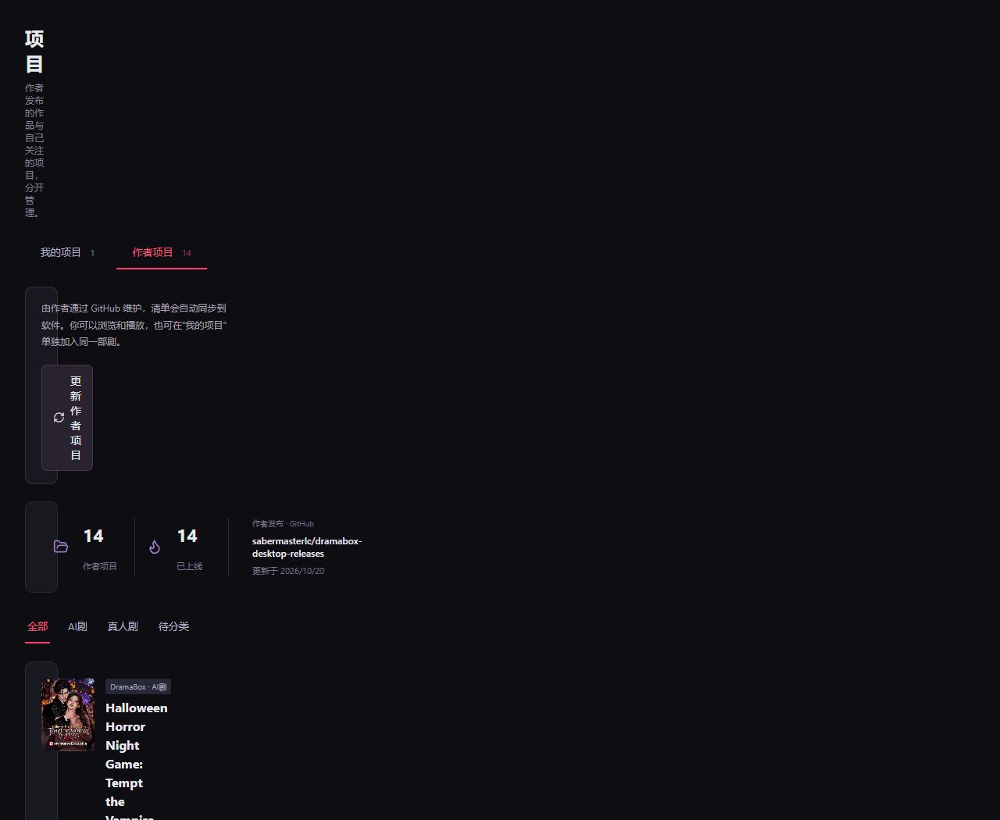
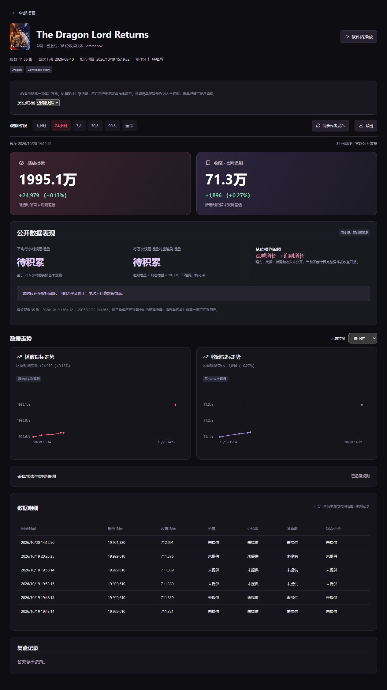

# 项目与数据记录

[返回项目首页](../README.md) · [作者项目清单](../projects.json)

「我的项目」保存用户自己的作品和本机记录；「作者项目」读取维护者公开发布的作品与指标，两者独立保存。普通用户无需重新下载安装包，在作者项目页面同步即可看到新作品。

## 新增作者作品

[Halloween Horror Night Game: Tempt the Vampire to Survive](https://www.dramabox.com/drama/42000030917/Halloween-Horror-Night-Game-Tempt-the-Vampire-to-Survive)

| 项目 | 首次实际观测 |
| --- | --- |
| 官网编号 | 42000030917 |
| 集数 | 51 |
| 官网首次上架记录 | 2026-10-20（保留官网日期） |
| 观测时间 | 2026-10-20 14:28:41，Asia/Shanghai（UTC 06:28:41） |
| 观看指标 viewCount | 25,429 |
| 追剧指标 followCount | 5,052 |

从这次实际读取开始记录，不倒推历史。官网没有提供的热度、评论数、弹幕数保持为空，不记作零，也不使用搜索结果的 clickNum 代替详情 viewCount。

## 数据如何保存？

作者采集端在作者电脑运行并启用时，按 5 分钟周期读取公开详情；成功观测先写本机待发布队列，再合并到 GitHub。失败保留队列，不补造采集点。退出、休眠和关机期间不采集；这不是全天候云端数据服务。

项目近期最多 288 条观测保存在 [projects.json](../projects.json)，完整记录按 UTC 月份保存在 [project-history/](../project-history/)，由 historyFiles 索引。清单与归档同一次提交，保留数据来源和原始观测时间。普通用户端约每 15 分钟同步作者清单，也可手动更新。

「我的项目」自动采集默认关闭；可在软件中自行开启并调整间隔。个人项目、观影笔记、账号信息和私人记录不上传作者仓库。

## 趋势与复盘

支持时间范围、同来源趋势、播放 / 收藏等可用指标、原始明细、CSV 导出及复盘笔记。只有一条记录时显示单个点，有两条同来源有效记录才计算区间变化；没有连续观测的时段不补点。截图中的已有项目用于展示历史界面，新剧的走势从首份实际观测逐步形成。

官网未公开观看与追剧指标的统计口径，不能把它们当作后台精确播放量、收入、投放效果或手机端同口径数据。不同来源不混为同一条曲线。
